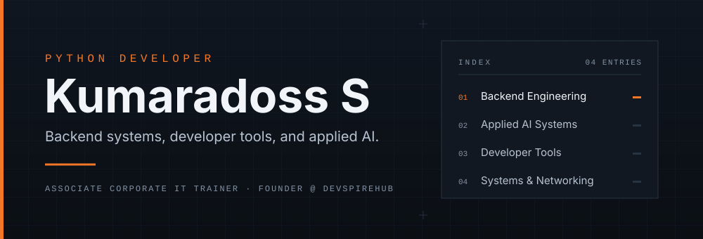

  

  

  <a href="https://github.com/kumaradoss16">GitHub</a> &nbsp;·&nbsp;
  <a href="https://www.linkedin.com/in/kumaradoss-s/">LinkedIn</a> &nbsp;·&nbsp;
  <a href="mailto:kumaradoss.py@gmail.com">Email</a> &nbsp;·&nbsp;
  <a href="https://devspirehub.com">DevSpireHub</a>

 

## 01 / About

👨‍💻 <strong>Python Developer</strong> building backend applications, REST APIs, automation workflows, and developer tools.

⚙️ <strong>System &amp; Network Engineer</strong> by background — Linux, Windows, networking, and infrastructure fundamentals shape how I build, test, and troubleshoot.

🧠 <strong>Applied AI</strong> as an engineering practice — RAG pipelines, AI agents, MCP integrations, and workflow automation with validation and deterministic fallbacks.

🌐 <strong>Local-first delivery</strong> — Python services behind React interfaces, desktop shells, and workflows that keep data on the machine.

📚 <strong>Associate Corporate IT Trainer</strong> — delivering technical training in programming, Linux, and networking.

<strong>ROLE</strong> &nbsp;Associate Corporate IT Trainer 
<strong>FOCUS</strong> &nbsp;Python backend&nbsp;· automation&nbsp;· developer tools 
<strong>BUILDING</strong> &nbsp;Local-first tools and LLM engineering patterns 
<strong>BASED IN</strong> &nbsp;Puducherry, India

 

## 02 / Engineering Focus

| 01 / BACKEND  <strong>Backend Engineering</strong> | 02 / APPLIED AI  <strong>Applied AI Systems</strong> |
|:--|:--|
| Python services and REST APIs with explicit schemas, validation, and structured error handling.  <code>Python</code> <code>Flask</code> <code>FastAPI</code> <code>Pydantic</code> | RAG, agentic workflows, and MCP integrations built around validation and deterministic fallbacks.  <code>RAG</code> <code>AI agents</code> <code>MCP</code> <code>Workflow automation</code> |
| 03 / TOOLING  <strong>Developer Tools</strong> | 04 / SYSTEMS  <strong>Systems &amp; Networking</strong> |
| Desktop and local-first applications that automate repetitive work and keep data on the machine.  <code>Python</code> <code>Tauri</code> <code>Rust</code> <code>C#</code> <code>.NET</code> | Linux, Windows, and network fundamentals applied to diagnostics, troubleshooting, and automation.  <code>Linux</code> <code>Windows</code> <code>Networking</code> <code>Docker</code> |

 

## 03 / Technical Stack

<strong>LANGUAGES &amp; BACKEND</strong> 
 <code>SQL</code> <code>REST APIs</code> <code>Pydantic</code>

<strong>FRONTEND &amp; WEB</strong> 

<strong>DATABASE</strong> 
 <code>SQL-based databases</code>

<strong>SYSTEMS &amp; NETWORKING</strong> 
 <code>Networking fundamentals</code> <code>System administration</code> <code>VMware</code> <code>Troubleshooting</code>

<strong>APPLIED AI</strong> 
 <code>LLM integration</code> <code>RAG</code> <code>AI agents</code> <code>MCP</code> <code>Workflow automation</code> <code>Prompt &amp; context engineering</code>

<strong>DESKTOP &amp; DEVELOPER TOOLS</strong> 
 <code>WPF</code> <code>n8n</code>

 

## 04 / Selected Projects

<table>
  <tr>
    <td width="31%" valign="top">
      <strong>01 / CONTENT WORKFLOW</strong>  
      🗂️ <strong><a href="https://github.com/kumaradoss16/PostFlow">PostFlow</a></strong>
    </td>
    <td width="69%" valign="top">
      A single-user, local-first desktop application for drafting source content, managing platform variants, AI-assisted generation, revision approval, and scheduled publishing.  
      Python&nbsp;· FastAPI&nbsp;· React&nbsp;· TypeScript&nbsp;· Rust 
      <a href="https://github.com/kumaradoss16/PostFlow">View repository →</a>
    </td>
  </tr>
  <tr>
    <td valign="top">
      <strong>02 / APPLIED AI</strong>  
      🧠 <strong><a href="https://github.com/kumaradoss16/llm-engineering-patterns">LLM Engineering Patterns</a></strong>
    </td>
    <td valign="top">
      A test-driven collection of LLM engineering patterns — classification, extraction, summarization, semantic search, and retrieval-augmented generation — with validated outputs, telemetry, and deterministic fallbacks.  
      Python&nbsp;· Pydantic&nbsp;· Ollama&nbsp;· RAG&nbsp;· pytest 
      <a href="https://github.com/kumaradoss16/llm-engineering-patterns">View repository →</a>
    </td>
  </tr>
  <tr>
    <td valign="top">
      <strong>03 / DESKTOP PUBLISHING</strong>  
      📝 <strong><a href="https://github.com/kumaradoss16/markdown-studio">MarkForge — Markdown Studio</a></strong>
    </td>
    <td valign="top">
      An offline-first desktop Markdown and LaTeX workspace with tabbed editing, live GFM preview, PDF export, revision history, and review-gated GitHub publishing.  
      JavaScript&nbsp;· TypeScript&nbsp;· C++&nbsp;· Tauri 
      <a href="https://github.com/kumaradoss16/markdown-studio">View repository →</a>
    </td>
  </tr>
  <tr>
    <td valign="top">
      <strong>04 / DESIGN TOOLING</strong>  
      🏷️ <strong><a href="https://github.com/kumaradoss16/labelforge">LabelForge Studio</a></strong>
    </td>
    <td valign="top">
      A label design studio for desktop and tablet, covering template presets, barcode generation, and print workflows.  
      TypeScript&nbsp;· React&nbsp;· Vite&nbsp;· Express 
      <a href="https://github.com/kumaradoss16/labelforge">View repository →</a>
    </td>
  </tr>
  <tr>
    <td valign="top">
      <strong>05 / BACKEND API</strong>  
      🌐 <strong><a href="https://github.com/kumaradoss16/network-diagnostic-api">Network Diagnostic API</a></strong>
    </td>
    <td valign="top">
      A FastAPI service exposing ping, DNS, TCP port, HTTP/HTTPS, and latency checks as validated REST endpoints, with structured errors and optional private-target blocking.  
      Python&nbsp;· FastAPI&nbsp;· Pydantic&nbsp;· httpx 
      <a href="https://github.com/kumaradoss16/network-diagnostic-api">View repository →</a>
    </td>
  </tr>
  <tr>
    <td valign="top">
      <strong>06 / SECURITY TOOLING</strong>  
      🔎 <strong><a href="https://github.com/kumaradoss16/linux-log-analyzer">Linux Log Analyzer</a></strong>
    </td>
    <td valign="top">
      A zero-dependency Python CLI and local web dashboard for Linux auth, system, and web logs, with brute-force detection, compromise indicators, and text or JSON report export.  
      Python&nbsp;· stdlib&nbsp;· Vanilla JS 
      <a href="https://github.com/kumaradoss16/linux-log-analyzer">View repository →</a>
    </td>
  </tr>
</table>

 

## 05 / Digital Platforms

<table>
  <tr>
    <td width="31%" valign="top">
      <strong>PLATFORM 01</strong>  
       <strong><a href="https://devspirehub.com">DevSpireHub</a></strong> 
      devspirehub.com
    </td>
    <td width="69%" valign="top">
      A technical learning platform covering programming, Python, AI, cybersecurity, networking, automation, Linux, Windows, and practical development guides.  
      <a href="https://devspirehub.com">Visit platform →</a>
    </td>
  </tr>
  <tr>
    <td valign="top">
      <strong>PLATFORM 02</strong>  
       <strong><a href="https://nexus.devspirehub.com">DevSpire Nexus</a></strong> 
      nexus.devspirehub.com
    </td>
    <td valign="top">
      A technical resource discovery platform focused on AI applications, developer tools, productivity software, and useful technical resources.  
      <a href="https://nexus.devspirehub.com">Visit platform →</a>
    </td>
  </tr>
  <tr>
    <td valign="top">
      <strong>PLATFORM 03</strong>  
       <strong><a href="https://portfolio.devspirehub.com">Developer Portfolio</a></strong> 
      portfolio.devspirehub.com
    </td>
    <td valign="top">
      A professional portfolio featuring my technical background, engineering interests, and selected projects.  
      <a href="https://portfolio.devspirehub.com">Visit portfolio →</a>
    </td>
  </tr>
</table>

 

## 06 / Education

<strong>MSc</strong> &nbsp;Materials Science and Technology 
<strong>BSc</strong> &nbsp;Physics 
<strong>ADVANCED DIPLOMA</strong> &nbsp;System and Network Engineering 
<strong>DIPLOMA</strong> &nbsp;Python and Flask Framework

 

## 07 / Connect

  <a href="https://github.com/kumaradoss16">&nbsp;GitHub</a> &nbsp;·&nbsp;
  <a href="https://www.linkedin.com/in/kumaradoss-s/">&nbsp;LinkedIn</a> &nbsp;·&nbsp;
  <a href="https://devspirehub.com">&nbsp;DevSpireHub</a> &nbsp;·&nbsp;
  <a href="https://nexus.devspirehub.com">&nbsp;DevSpire Nexus</a> &nbsp;·&nbsp;
  <a href="https://portfolio.devspirehub.com">&nbsp;Portfolio</a>

 

<strong>Kumaradoss</strong> — Python Developer&nbsp;· System &amp; Network Engineer

